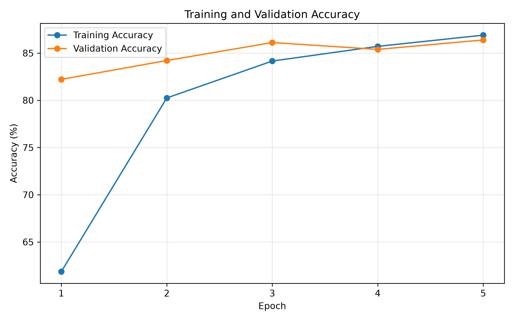
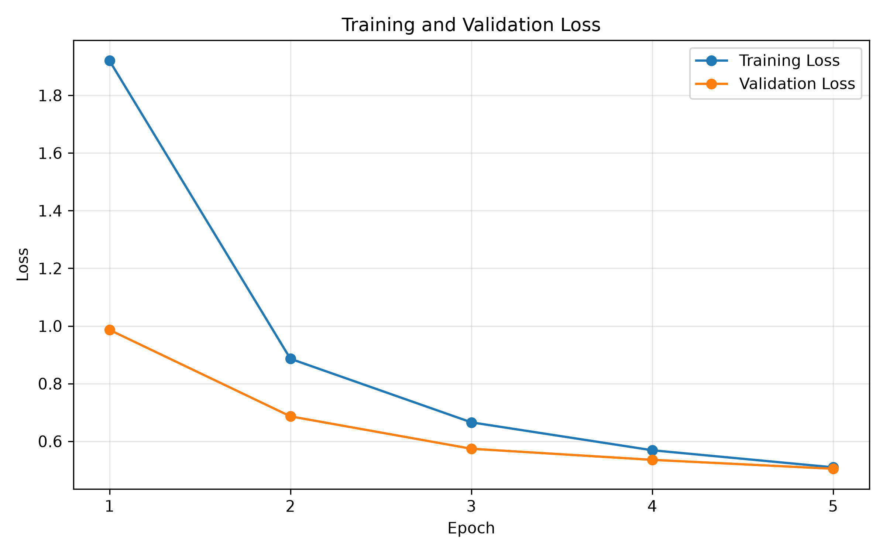
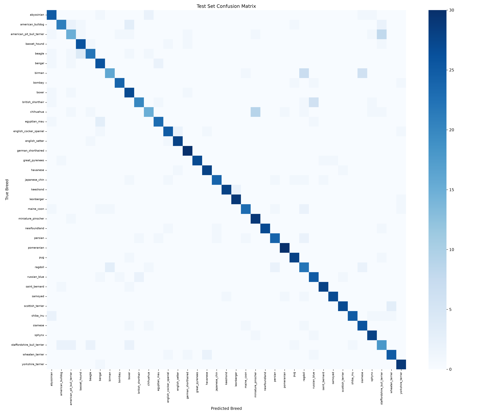
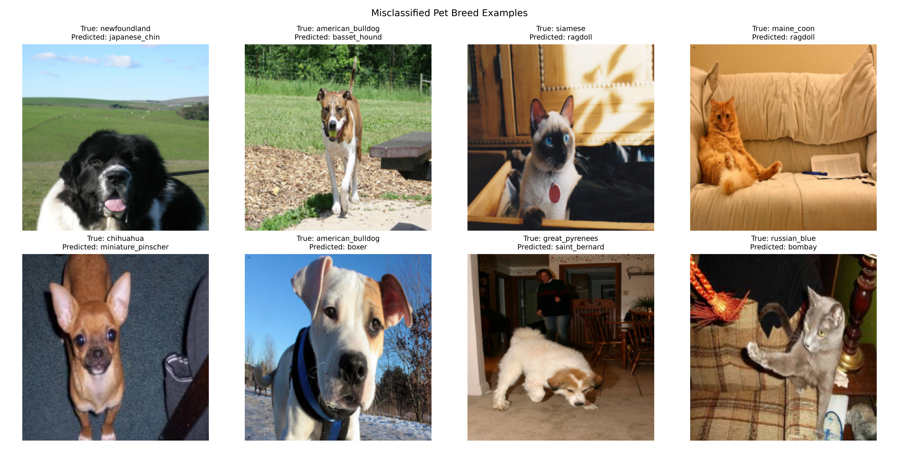

# 🐾 Pet Breed Detection

A deep learning project that classifies **37 pet breeds** (cats and dogs) using transfer learning with **EfficientNet-B0**, trained on the Oxford-IIIT Pet Dataset.

---

## 📊 Results

| Metric | Value |
|--------|-------|
| Overall Accuracy | **83.41%** |
| Macro Avg Precision | 84.01% |
| Macro Avg Recall | 83.39% |
| Macro Avg F1-Score | 83.24% |

### Training Curves



### Evaluation



---

## 🐶🐱 Breeds Covered

37 breeds from the [Oxford-IIIT Pet Dataset](https://www.robots.ox.ac.uk/~vgg/data/pets/):

**Dogs:** American Bulldog, American Pit Bull Terrier, Basset Hound, Beagle, Boxer, Chihuahua, English Cocker Spaniel, English Setter, German Shorthaired, Great Pyrenees, Havanese, Japanese Chin, Keeshond, Leonberger, Miniature Pinscher, Newfoundland, Pomeranian, Pug, Saint Bernard, Samoyed, Scottish Terrier, Shiba Inu, Staffordshire Bull Terrier, Wheaten Terrier, Yorkshire Terrier

**Cats:** Abyssinian, Bengal, Birman, Bombay, British Shorthair, Egyptian Mau, Maine Coon, Persian, Ragdoll, Russian Blue, Siamese, Sphynx

---

## 🏗️ Model Architecture

- **Base Model**: EfficientNet-B0 (pretrained on ImageNet)
- **Task**: Multi-class classification (37 breeds)
- **Framework**: PyTorch
- **Weights**: `efficientnet_b0_petbreed.pth`

---

## 📁 Repository Structure

```
pet_breed_detection/
├── efficientnet_b0_petbreed.pth   # Trained model weights
├── per_breed_metrics.csv          # Per-breed precision, recall, F1
├── accuracy_curves.png            # Train/val accuracy over epochs
├── loss_curves.png                # Train/val loss over epochs
├── confusion_matrix.png           # Confusion matrix on test set
└── misclassified_examples.png     # Sample misclassified images
```

---

## 📈 Per-Breed Performance Highlights

| Breed | F1-Score |
|-------|----------|
| 🥇 Pomeranian | 96.77% |
| 🥈 Leonberger | 95.08% |
| 🥉 Keeshond | 94.92% |
| Newfoundland | 94.74% |
| Great Pyrenees | 94.74% |
| ... | ... |
| American Pit Bull Terrier | 55.56% |
| Staffordshire Bull Terrier | 59.02% |

---

## 🗂️ Dataset

The project uses the [Oxford-IIIT Pet Dataset](https://www.robots.ox.ac.uk/~vgg/data/pets/).  
The dataset is **not included** in this repo due to its large size (~800MB).

To download the dataset:
```bash
# Images
wget https://thor.robots.ox.ac.uk/pets/images.tar.gz

# Annotations
wget https://thor.robots.ox.ac.uk/pets/annotations.tar.gz
```

---

## 🚀 Getting Started

```bash
# Clone the repo
git clone https://github.com/IrfanM-7/pet_breed_detection.git
cd pet_breed_detection

# Create virtual environment
python -m venv .venv
.venv\Scripts\activate   # Windows

# Install dependencies
pip install torch torchvision efficientnet_pytorch pillow
```

---

## 📝 License

This project is open-source and available under the [MIT License](LICENSE).
